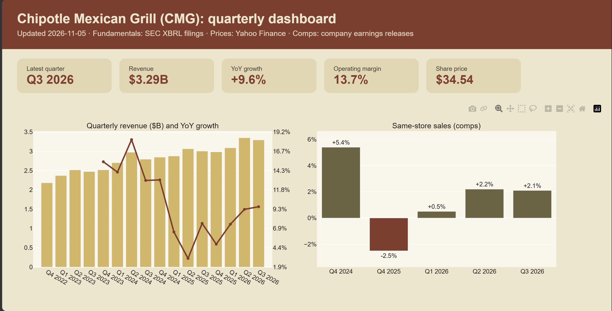
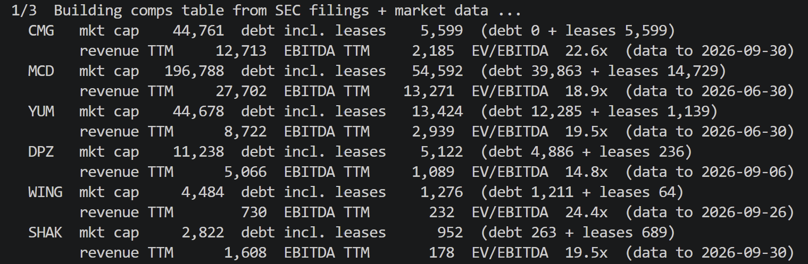
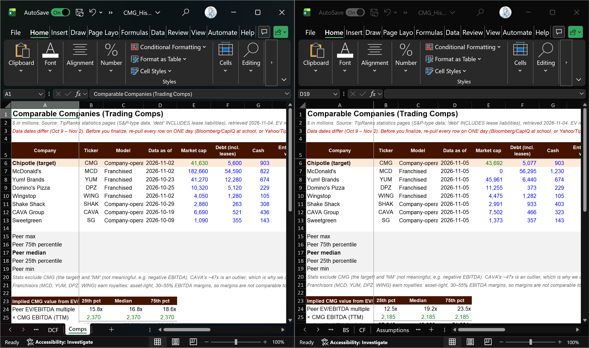

# Data Pipeline: one-command refresh of the CMG model

Updating a DCF model by hand every quarter means copying dozens of numbers from 10-K and 10-Q filings for the company and its peers, which is slow and easy to get wrong.

This pipeline pulls the latest filings for Chipotle and 7 restaurant peers straight from the **SEC XBRL API**, computes trailing-twelve-month (TTM) revenue and EBITDA, fetches market data with **yfinance**, and writes the fresh inputs into the Excel DCF model ([`CMG_Historicals_Assumptions.xlsx`](../CMG_Historicals_Assumptions.xlsx)) with **openpyxl**. It also builds a quarterly dashboard with **Plotly**. The whole refresh is one command:

```bash
python run_all.py
```



## What it does

1. **Downloads filings**: latest 10-K / 10-Q figures for CMG, MCD, YUM, DPZ, WING, SHAK, CAVA and SG from `data.sec.gov`
2. **Computes TTM figures**: last fiscal year + current year-to-date − prior year-to-date, plus the latest cash, debt and operating lease balances
3. **Pulls market data**: share prices and market caps from Yahoo Finance
4. **Updates the Excel model**: Comps tab, share price (WACC tab), cash and diluted shares (DCF tab). A dated backup is saved first and formulas are never overwritten
5. **Builds a dashboard** (`output/cmg_dashboard.html`): quarterly revenue and YoY growth, same-store sales, operating margin, food and labor cost ratios, share price, EV/EBITDA vs peers



<!-- Screenshot: Comps tab before and after a refresh
 -->

## Project structure

```
data-pipeline/
├── run_all.py               # entry point: runs the full refresh
├── requirements.txt
├── cmg_pipeline/
│   ├── config.py            # companies, XBRL tags, file paths
│   ├── sec.py               # SEC XBRL download, caching, TTM and quarterly logic
│   ├── market.py            # share prices and market caps (yfinance)
│   ├── comps.py             # builds the comps table and writes it into Excel
│   ├── dashboard.py         # Plotly dashboard
│   └── comps_manual.csv     # same-store sales (not available in XBRL)
└── tests/
    └── test_offline.py      # runs the whole pipeline on fake data, no internet
```

## Setup

```bash
pip install -r requirements.txt
```

The SEC requires every automated request to include a name and contact email. Copy `cmg_pipeline/config_local.example.py` to `cmg_pipeline/config_local.py` and put your own details in it. That file is in `.gitignore`, so it is never uploaded.

## Usage

Run from inside the `data-pipeline/` folder. It updates `CMG_Historicals_Assumptions.xlsx` at the root of this repo:

```bash
python run_all.py                  # update model + dashboard
python run_all.py --no-excel       # dashboard and comps CSV only
python run_all.py --refresh        # ignore today's cached SEC downloads
python run_all.py --model path/to/model.xlsx
```

Outputs go to `data-pipeline/output/`. Open the Excel model afterwards; it recalculates on open.

## Design notes

- **Picking the latest data**: the SEC API returns every value a company has ever reported. The pipeline keeps only 10-K / 10-Q filings, and when the same period was reported more than once, the most recently filed value wins
- **Tag fallbacks**: companies label the same line item with different XBRL tags (e.g. `Revenues` vs `RevenueFromContractWithCustomerExcludingAssessedTax`), so `config.py` lists several tags per item and uses the first one found
- **Comparable EV/EBITDA**: debt includes operating lease liabilities for every company, so restaurant peers that lease most of their stores are on the same basis
- **Same-store sales** are not in XBRL filings. After each earnings release, add one row to `cmg_pipeline/comps_manual.csv`
- **Scenarios tab**: stored Bull / Base / Bear results are not refreshed automatically. Switch the selector to 1, 2 and 3 and re-record them after a refresh

## Testing

```bash
python tests/test_offline.py ../CMG_Historicals_Assumptions.xlsx
```

Runs the full pipeline on fake SEC and market data against a copy of the model, without internet access.
